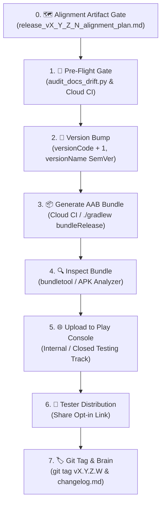

# 🚀 Google Play Console Release & Deployment Workflow

> **Standard Operating Procedure for ShellGuard Mobile Releases**  
> *Engineered for Android App Bundle (`.aab`) Generation, Keystore Signing, 16 KB Alignment Verification, and Play Console Distribution.*

---

## 📋 Workflow Overview



---

## 🗺️ Step 0: The Alignment & Rollout Artifact Gate (Mandatory Pre-Draft)

Before modifying code, bumping versions, merging branches, or drafting release notes, generate a comprehensive alignment artifact (`release_vX_Y_Z_N_alignment_and_rollout_plan.md`) with `request_feedback = true`:

```text
The artifact MUST systematically capture:
1. What Needs Alignment: Complete audit of all repository anchors (app/build.gradle.kts, README.md, CHANGELOG.md, SECURITY.md, RELEASE-PLAY.md, ROADMAP.md, meta-prompt, brain files).
2. What Needs Alignment in It: Specific line numbers, stale version badges, character limits (<500 chars), and outdated references.
3. How to Align Everything: Concrete proposed diffs, legacy manifest prunings, and link updates.
4. The Roll-Off Execution Protocol: Step-by-step checklist of shell commands, PR merges, fast-forwards, and tag pushes allowing immediate execution straight from the artifact upon approval.
```

> [!IMPORTANT]
> **Awaiting Feedback**: Stop calling tools and allow the user to review, edit, or approve the alignment artifact before proceeding with file mutations.

---

## 🛠️ Step 1: Pre-Flight Verification Gate

Run the sub-second deterministic documentation drift auditor locally before drafting:

```bash
python3 scripts/audit_docs_drift.py
```

*Note on Local Gradle*: Full unit testing (121+ Robolectric tests) and release bundle compilation are offloaded to GitHub Actions Cloud CI (`.github/workflows/ci.yml`). Do not run `./gradlew testDebugUnitTest` or `./gradlew assembleDebug` locally unless debugging offline.

### Invariants to Verify:
- [ ] **Target SDK API 36**: Google Play Console strictly mandates `targetSdk = 36` (Android 16). Any bundle targeting API 35 or lower will be rejected during upload validation.
- [ ] **Tests Passing in Cloud**: 100% pass rate across all Robolectric and unit tests on GitHub Actions.
- [ ] **16 KB Alignment**: `gradle/libs.versions.toml` specifies `sqlcipher = "4.6.1"` and `app/build.gradle.kts` specifies `jniLibs.useLegacyPackaging = false`.
- [ ] **Security Boundaries**: `FLAG_SECURE` active for production builds (`!BuildConfig.DEBUG` in `MainActivity.kt`).
- [ ] **Network Security**: Cleartext permitted strictly for local LAN / VPN origins in `res/xml/network_security_config.xml`.
- [ ] **ProGuard Rules**: `app/proguard-rules.pro` preserves SQLCipher JNI, Kotlinx Serialization, and Room DAOs.

---

## 🔢 Step 2: Versioning Protocol

Every release bundle uploaded to Google Play **MUST** have a strictly higher `versionCode` than any previously uploaded bundle.

Edit [`app/build.gradle.kts`](file:///config/Local-Storage/workspace-lucas/projects/Agents/ShellGuard-Mobile/app/build.gradle.kts):

```kotlin
android {
    defaultConfig {
        applicationId = "com.clawstack.shellguard"
        minSdk = 24
        targetSdk = 36
        versionCode = N + 1         // Increment monotonically (+1 integer for every upload: 1, 2, 3...)
        versionName = "X.Y.Z.N"     // SemVer display version (e.g. "0.0.0.1", "0.0.0.2", "1.0.0.0"...)
    }
}
```

> [!TIP]
> **Durable Conflict Resolution: Updating a Release Without Bumping Version Name**:
> If you need to re-upload or hotfix a release under the same user-facing version name (e.g. `vX.Y.Z.N`), keep `versionName = "X.Y.Z.N"` unchanged and increment `versionCode` (e.g. `N` ➔ `N + 1`). In Google Play Console, it will appear as `X.Y.Z.N (Build N+1)`, and the app UI will seamlessly continue displaying `vX.Y.Z.N`.

---

## 📦 Step 3: Generate Signed Release Artifacts

### 🚀 Recommended: Automated Cloud Build via GitHub Actions (Zero Local CPU Drain)
To avoid local machine resource exhaustion, use the cloud release pipeline:

1. **Trigger via Commit Flag or Git Tag**:
   ```bash
   # Method A: Commit flag on main
   git commit -m "chore(release): release vX.Y.Z.N (Build N) --release vX.Y.Z.N"
   git push origin main

   # Method B: Git tag
   git tag vX.Y.Z.N
   git push origin vX.Y.Z.N
   ```
2. **Download Signed Artifacts**:
   - Navigate to GitHub **Actions** or **Releases** on `ClawStackStudios/ShellGuard-Mobile`.
   - Download the signed `shellguard-mobile-vX.Y.Z.N.aab` (for Google Play Console) and `shellguard-mobile-vX.Y.Z.N.apk` (for direct sideloading).

### 💻 Alternative: Local Build (Requires Local Keystore)
If building locally, run:
```bash
./gradlew bundleRelease assembleRelease
```
Artifacts output to:
- `app/build/outputs/bundle/release/app-release.aab`
- `app/build/outputs/apk/release/app-release.apk`
> User-facing version labels dynamically bind to `BuildConfig.VERSION_NAME`.

---

## 🔑 Step 4: Keystore Generation & GitHub Actions Secrets Setup

Google Play uses **Play App Signing**. You sign the bundle with your **Upload Key**, and Google signs the final APK delivered to user devices with the App Signing Key.

### A. Generate Upload Keystore (`keytool`)
Run `keytool` (bundled with Android Studio's JBR) to generate `my-upload-key.jks`:

```bash
# 1. Generate the RSA 2048-bit JKS Keystore (valid for 25+ years)
/config/Applications/android-studio/jbr/bin/keytool -genkeypair -v \
  -keystore my-upload-key.jks \
  -alias upload \
  -keyalg RSA \
  -keysize 2048 \
  -validity 10000 \
  -storetype JKS
```
*Prompt tips:*
- Enter a strong keystore password and key password.
- When prompted for "What is your first and last name?", enter `ClawStack Studios`.
- Fill in organizational details as desired, then type `yes` to confirm.

### B. Base64 Encode for GitHub Secrets
Convert the binary `.jks` file into a single-line base64 string:

```bash
# 2. Encode to single-line base64 (no line wrapping)
base64 -w 0 my-upload-key.jks > upload-key.base64.txt
```

> [!CAUTION]
> **Android Secrets Safety**: `my-upload-key.jks` and `*.base64.txt` contain private signing keys and must **NEVER** be committed to Git. Both patterns are already guarded in `.gitignore`. Store the `.jks` in a secure offline location (e.g., your ShellGuard vault!).

### C. Configure GitHub Repository Secrets
In your GitHub repository (`ClawStackStudios/ShellGuard-Mobile`), navigate to **Settings** → **Secrets and variables** → **Actions** → **New repository secret**:

| Secret Name | Value | Description |
| :--- | :--- | :--- |
| `ANDROID_SIGNING_KEY` | *(Paste entire contents of `upload-key.base64.txt`)* | Base64-encoded upload keystore |
| `ANDROID_KEYSTORE_PASSWORD` | *(Your keystore password)* | Master password used in `keytool` |
| `ANDROID_KEY_ALIAS` | `upload` | Alias specified during `-alias upload` |
| `ANDROID_KEY_PASSWORD` | *(Your key password)* | Key password used in `keytool` |

---

## 🔍 Step 5: Validate 16 KB Page-Size Alignment

Before uploading to Play Console, verify native binary page-size alignment:

```bash
# Verify libsqlcipher.so is 16 KB aligned
zipinfo -v app/build/outputs/bundle/release/app-release.aab | grep -A 2 "libsqlcipher.so"
```
The file offset must be evenly divisible by `16384` (16 KB), confirming Android 15/16 compatibility.

---

## 🌐 Step 6: Google Play Console Release Upload

1. Navigate to the **[Google Play Console](https://play.google.com/console)**.
2. Select **ShellGuard Mobile** (`com.clawstack.shellguard`).
3. In the left-hand sidebar, navigate to **Testing** → **Internal testing** (or **Closed testing**).
4. Click **Create new release** (top right).
5. **Upload Bundle**: Drag and drop `shellguard-mobile-vX.Y.Z.N.aab` into the upload zone.
6. **Release Name**: Play Console will automatically populate `X.Y.Z.N (Build N)` matching your Gradle config.
7. **Release Notes**: Copy the formatted `<en-US>` notes directly from [`RELEASE-PLAY.md`](file:///config/Local-Storage/workspace-lucas/projects/Agents/ShellGuard-Mobile/RELEASE-PLAY.md) (<500 characters):
   ```xml
   <en-US>
   • Ktor Network & Sync: Direct connection to self-hosted ShellGuard servers over LAN or mesh.
   • Vault Dashboard: Unified view of passwords, notes, and SSH keys with real-time search & pod filters.
   • Bitwarden-Model Offline Caching: Full read, search, and copy access with zero split-brain conflicts.
   • Base62 Key Parity: Native support for all sovereign ShellKey identity files.
   • Soft Keyboard Polish: Smooth cursor retention with zero blackout.
   • Hardware Security: Android KeyStore, SQLCipher AES-256, 16 KB page-aligned.
   </en-US>
   ```
8. Click **Next** → **Save** → **Review release** → **Start rollout to Internal testing**.

---

## 👥 Step 7: Manage & Distribute to Testers

1. In Play Console under **Internal testing**, open the **Testers** tab.
2. Create an **Email list** (e.g. `ShellGuard Alpha Testers`) and add your testers' Google account emails.
3. Scroll down to **How testers join your test** and copy the **"Join on Android"** link or **"Join on the web"** link.
4. Share the link with your testers:
   - Testers tap the link on their Android device.
   - Tap **Accept Invite**.
   - Download/update the app directly from the Google Play Store!

---

## 🏷️ Step 8: Post-Release Tagging & Brain Sync

> [!IMPORTANT]
> **🛡️ Single Active Release Manifest Invariant & Root Cleanliness:**
> 1. **Single Discrete Manifest at Root**: The repository root must maintain **strictly ONE** version-stamped release manifest matching current `app/build.gradle.kts`: `RELEASE-vX.Y.Z.N.md` (alongside `RELEASE-PLAY.md`).
> 2. **Prune Superseded Manifests**: Upon drafting a new release, cleanly delete prior root release manifests (`git rm RELEASE-v<old>.md`) and remove their references from `README.md`.
> 3. **Title & Date Invariant**: The heading MUST declare the version, build code, and release date:  
>    `# Release Manifest: vX.Y.Z.N (Build N) — YYYY-MM-DD` (e.g. `# Release Manifest: v0.0.0.12 (Build 12) — 2026-10-12`).
> 4. **Immutable History Preserved in Tags & Changelog**: Full historical release notes are permanently preserved in `CHANGELOG.md`, `RELEASE-PLAY.md` `<en-US>` history blocks, and git release tags. Root files are the active storefront, not an archival attic.

After rollout, tag the repository and update project history:

```bash
# Tag the git commit matching the release version
git tag -a v0.0.0.1 -m "Release v0.0.0.1 (Build 1) to Google Play Internal Testing"
git push origin v0.0.0.1
```

### Update Brain:
1. Append details to [`.agents/brain/project/changelog.md`](file:///config/Local-Storage/workspace-lucas/projects/Agents/ShellGuard-Mobile/.agents/brain/project/changelog.md).
2. Record the rollout event in [`.agents/brain/activeContext.md`](file:///config/Local-Storage/workspace-lucas/projects/Agents/ShellGuard-Mobile/.agents/brain/activeContext.md).

