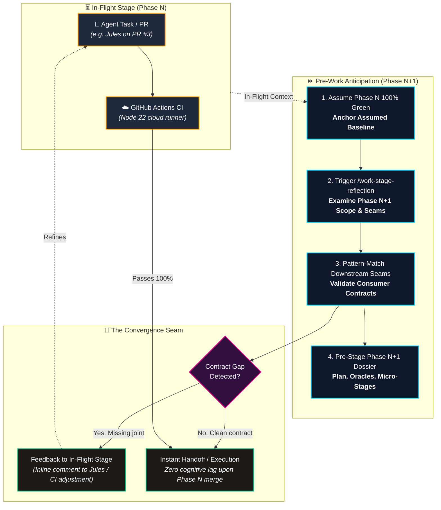

# ⏩ Pre-Work Assumptions Protocol (/pre-work-assumptions)

> **The Philosophical Stance:**
> *"Ok this work we gave Jules is now done. What do we look at next?  
> `/work-stage-reflection`  
> What can I do now, to get ahead of this work by basing my pattern matching in the work that is assumed to be complete?"*

---

## 🧭 Core Philosophy & Rationale

In asynchronous multi-agent pairing and cloud-offloaded CI development (e.g., Jules implementing a task on a persistent stage branch, GitHub Actions running remote verification, or PR reviews in-flight), orchestrator and developer idle time represents high cognitive entropy. 

Sitting idle waiting for an in-flight stage to finish is a wasted opportunity. However, recklessly writing ungrounded code that races against an active branch creates merge collisions and phantom state.

**The Pre-Work Assumptions Protocol** solves this by establishing an anticipatory cartography stance:
1. **Assume Completion**: Treat the in-flight deliverables as 100% green, merged, and structurally sound.
2. **Shift Perspective Forward**: Leap one stage ahead and initiate `/work-stage-reflection` on the immediate successor milestone.
3. **Pattern-Match Downstream Seams**: Trace how upcoming modules will consume the assumed outputs (APIs, schemas, file trees, cryptographic guarantees).
4. **Surface Cross-Stage Gaps Early**: If the downstream stage needs a field, hook, or guarantee that the in-flight stage omitted, surface that feedback immediately into the active PR/task before the current stage closes.
5. **Pre-Stage Deliverables**: Author the forward reflection artifacts, draft verification oracles, and prepare bite-sized micro-stage prompts so handoff or execution is instantaneous the second the current stage lands.

---

## ⚡ Visual Pipeline & Orchestration Flow

---

## 🎯 Execution Triggers

This workflow activates when the user or orchestrator triggers:
- `/pre-work-assumptions`
- `/pre-work`
- *"Ok this work we gave Jules is now done. What do we look at next?"*
- *"Let's get one step ahead of the work."*
- *"Assume in-flight work is complete and plan the next stage."*
- When an agent (such as Jules) is actively working on a delegated task or PR, and the orchestrator needs to map the downstream stage immediately without idle waiting.

---

## 📋 The 4-Phase Operational Method

### Phase 1: In-Flight Baseline Anchorage
Before leaping forward, clearly define what is assumed to be true:
1. **Identify the In-Flight Unit**: Name the active phase, branch, and responsible actor (e.g., `Phase 23: Bitwarden-Model Item Integrity`, branch `stage/phase-23-item-integrity`, actor: `Jules` on PR #3).
2. **Define the Assumed Baseline Contract**:
   - *Capabilities*: What operations now exist and succeed?
   - *API Endpoints*: What routes, status codes, and JSON schemas are assumed live?
   - *Data Layer*: What columns, tables, foreign keys, or migrations are assumed committed?
   - *UI Surfaces*: What views, components, badges, or layouts are assumed rendered?
3. **Record Boundaries**: Explicitly state what was delivered in Phase N and what was left untouched.

### Phase 2: Pivot Forward via `/work-stage-reflection`
With the assumed baseline anchored, mentally step across the threshold into Phase N+1 and execute the 6-Section Framework from [.agents/workflows/work-stage-reflection.md](file:///config/Local-Storage/workspace-lucas/projects/Agents/ShellGuard/.agents/workflows/work-stage-reflection.md):

1. **Scope**: What does Phase N+1 introduce? What depends directly on Phase N? What is strictly out of scope?
2. **Architecture & Integration**: How does Phase N+1 connect to the seams established by Phase N? What new files are required? What files are modified?
3. **Configuration & Settings**: What new environment variables, feature flags, or storage ceilings are needed?
4. **Security & Trust Boundaries**: What new attack surfaces or zero-knowledge boundaries does Phase N+1 introduce?
5. **Verification & Completion Criteria**: What concrete testable conditions define completion for Phase N+1? How will cloud CI verify them?
6. **Risks & Decisions Needed**: What falsifiable assumptions could break Phase N+1? What user decisions are required?

### Phase 3: Pattern-Matching Against the Assumed Topology
Actively stress-test the interface between the assumed Phase N outputs and the planned Phase N+1 consumers:
1. **Consumer Contract Audit**:
   - *Does Phase N+1 have everything it needs from Phase N?*
   - *Example*: Phase 25 (`habitatExport.ts` streaming ZIP) requires Phase 23's `attachments/<pod>/<item_title>__[<id_short>]/<file_name>` parent-linked folder structure and Phase 24's zero-migration cryptographic fallback. If Phase 23 failed to expose the parent item title on attachment records, Phase 25's export would break!
2. **Early Feedback Loop (The Catch)**:
   - If a gap or missing joint is found during the forward reflection, **do not wait** for Phase N to merge.
   - Formulate an immediate, constructive review comment or instruction for the in-flight actor (e.g. posting directly to Jules on the open PR).
   - Fixing the joint while the code is already open in Phase N saves an entire cycle of post-merge refactoring.

### Phase 4: Pre-Staging Artifacts, Test Oracles & Micro-Stages
Transform the forward reflection into concrete, tangible readiness artifacts:
1. **Author the Reflection Artifact**: Save the forward implementation plan in the active artifact directory (e.g. `stage_<N+1>_work_stage_reflection.md` or `stage_<N+1>_implementation_plan.md`).
2. **Pre-Stage Verification Oracles**: Define exact test scenarios, mock export fixtures, and Vitest suite requirements so they are ready to be implemented without delay.
3. **Decompose into Micro-Stages**: Break Phase N+1 into bite-sized, sequential stages (e.g., Stage 1: Data model & fallback crypto, Stage 2: Streaming routes, Stage 3: Reactive UI components) ready for immediate delegation or direct execution the moment Phase N is merged.

---

## 🚫 Anti-Patterns & Redlines

- **Never Commit Speculative Code to the In-Flight Branch**: Do not edit or commit application code for Phase N+1 onto the active branch where Phase N is currently being worked on by another agent. Work in artifacts, plans, and documentation first.
- **Never Run Heavy Builds or Tests Locally**: Host machine resources are tightly constrained. Maintain strict adherence to `.agents/rules/git-hygiene.md` and `.agents/rules/cadence-and-lifecycle-prompts.md`. All heavy verification occurs in GitHub Actions cloud runners via `gh run watch`.
- **Never Address Jules with `@` Handles**: When formulating review comments or instructions for Jules, always refer to him plainly as `Jules` (never `@jules` or `@google-labs-jules[bot]`).
- **Never Cross Agent Boundaries**: Keep orchestrator rules and workflows strictly inside `.agents/`. Never write to or modify `.jules/` unless specifically preparing an explicit delegation task file.
- **Never Skip the Physical Baseline Verification**: When Phase N finally lands and merges, perform a rapid physical git and diff check to confirm that the real code matches the assumed baseline before executing Phase N+1 code edits.

---

## 📦 Deliverables Checklist

When running `/pre-work-assumptions`, the orchestrator produces:
- [ ] **Assumed Baseline Summary**: Bulleted list of assumed-complete capabilities, API endpoints, and schemas from in-flight work.
- [ ] **Forward Implementation Plan Artifact**: A comprehensive markdown artifact following the 6-section `/work-stage-reflection` standard for Phase N+1.
- [ ] **Cross-Phase Contract Audit**: Explicit verification that Phase N outputs satisfy Phase N+1 requirements, with any required adjustments posted to the active PR.
- [ ] **Micro-Staged Execution Dossier**: Numbered, dependency-ordered steps prepared for immediate execution or delegation upon merge.
