# 🤖 Master Meta-Prompt: ShellGuard Mobile — Feature Verification & Polish

> **INSTRUCTIONS & MULTI-STAGE PROMPTS FOR GOOGLE AI STUDIO (ANDROID BUILD MODE)**  
> *Aligned with ClawStack Mobile Standards and Google AI Studio Feature Architecture.*
>
> **Milestone Context**: The Genesis MVP (Stages 0–8 / Phases 1–7) is 100% complete and published up to `v0.0.0.11 (Build 11)`. The historical Genesis AI Studio meta-prompt is preserved at `.agents/internal/meta-prompt-ai-studio_MVP_GENESIS.md`.
>
> This active meta-prompt defines the **Feature Verification and Polish** meta-phase. It bridges remaining data gaps against the ShellGuard Web Server (Encrypted Attachments, Multi-URI), audits and polishes the full mental flow of the mobile client, and drives towards `structural_completion` at `v0.0.1.0`.

---

## 📋 Multi-Stage Execution Strategy

To ensure optimal token economy and avoid context degradation in **Google AI Studio**, development proceeds in deterministic 2-task stages mapped 1:1 to the **[`ROADMAP.md`](../ROADMAP.md)**:

```mermaid
flowchart TD
    classDef stageDone fill:#16231C,stroke:#10B981,stroke-width:2px,color:#F0F6FC;
    classDef stageActive fill:#1E252C,stroke:#06B6D4,stroke-width:2.5px,color:#F0F6FC;
    classDef stageNext fill:#21262D,stroke:#3D484E,stroke-width:1.5px,color:#F0F6FC;
    classDef targetMilestone fill:#1A2332,stroke:#10B981,stroke-width:2px,color:#F0F6FC;

    S1["<b>Stage 1: Full Server Parity — Encrypted Attachments & Multi-URI Bridge</b><br/>✅ Complete · Hardware-Verified (115 Tests Green)"]:::stageDone

    S1_SUB["<b>Stage 1 Sub-Phase: Vault Lock & Multi-Method Authentication</b><br/>⚡ <b>Active Focus</b> · Hardware Unblocker<br/>• Task 02.A: PinAuthManager (PBKDF2) & Settings UnlockMethod<br/>• Task 02.B: Security Settings UI, Reef PinPad & LockScreen Overhaul"]:::stageActive

    S2["<b>Stage 2: Mental Flow & Ergonomic Form Polish</b><br/>(Task 03: Cold-Start & Sub-16ms Search · Task 04: Touch Targets & Keyboard Insets)"]:::stageNext

    S3["<b>Stage 3: Security Lifecycle, Biometrics & Offline Resilience</b><br/>(Task 05: Lock Persistence & Offline Queue · Task 06: PIN Keypad & Panic Cascade)"]:::stageNext

    S4["<b>Stage 4: In-The-Wild Autofill Verification & Release Hardening</b><br/>(Task 07: Browser Autofill Gauntlet · Task 08: 16 KB Page Alignment & R8 ProGuard)"]:::stageNext

    S5["<b>Stage 5: First-Class HTTPS Transport & The Reef Handshake</b><br/>(Task 09: TOFU Pinning & Auto-Heal Engine · Task 10: QR Ingestion & Dual-Homed Mobility)"]:::stageNext

    M1["<b>🏆 Structural Completion: v0.0.1.0 (Build 16)</b><br/>Production-Grade Android Password Manager & Sync-Native Vault"]:::targetMilestone

    S1 --> S1_SUB --> S2 --> S3 --> S4 --> S5 --> M1
```



---

## 📎 Stage 1 Prompt: Full Server Parity — Encrypted Attachments & Multi-URI Bridge

> ✅ **STATUS: COMPLETED & HARDWARE-VERIFIED ON GOOGLE PIXEL (115/115 TESTS GREEN)**  
> *This prompt is retained as an immutable execution record. For active work, advance to [Stage 1 Sub-Phase Prompt](#-stage-1-sub-phase-prompt-vault-lock-responsiveness-pin-security--in-place-re-authentication).*
>
> 🗺️ **Master Roadmap Reference**: See [`ROADMAP.md`](../ROADMAP.md#stage-1-full-server-parity--encrypted-attachments--multi-uri-bridge) for complete specifications on **Task 01** and **Task 02**.  
> **📖 Required Context Files for Stage 1**:  
> 1. [`architecture.md`](./architecture.md) — Section 3 (Hybrid File-System Vault, CWE-400 defense).  
> 2. [`room-storage-schema.md`](./room-storage-schema.md) — Section 2.D (`SecureAttachmentEntity`), Section 3 (`SecureAttachmentDao`).  
> 3. [`crypto-and-keystore.md`](./crypto-and-keystore.md) — Section 1 (`vault_secure_attachments:{id}` AAD namespace).  
> 4. [`routes-and-contracts.md`](./routes-and-contracts.md) — Section 2.F (`/api/attachments` endpoints and DTOs).  

Copy and paste this prompt to execute **Stage 1 (Tasks 01 & 02)**:

```markdown
# STAGE 1 EXECUTION: Encrypted Attachments & Multi-URI Bridge

## 🎯 Objective
Achieve 100% data layer and synchronization parity with the ShellGuard server database across all 4 core tables (`vault_pearls`, `vault_secure_notes`, `vault_ssh_keys`, and `vault_secure_attachments`). Uphold the CWE-400 2MB CursorWindow defense by streaming ciphertext files directly to internal storage while maintaining reactive Room metadata.

## 📖 Reference Documentation
Before writing code, inspect:
- `architecture.md`: Hybrid File-System Vault architecture.
- `room-storage-schema.md`: `SecureAttachmentEntity` and `SecureAttachmentDao`.
- `crypto-and-keystore.md`: `vault_secure_attachments:{id}` AAD namespace.
- `routes-and-contracts.md`: Attachment routes and multipart wire contracts.

Execute Stage 1 adhering to the Functionality + UI Component pairing:

### Task 01: [Functionality] Attachments Network Engine, Hybrid Storage & Sync Repository Bridge
- Implement attachment endpoints in `ShellGuardClient.kt`:
  - `POST /api/attachments`: Multipart/form-data upload streaming pre-encrypted ShellCryption envelope bytes with progress tracking (`limits.fileSize = 500MB`).
  - `GET /api/attachments`: Fetch metadata list (`id`, `title`, `size_bytes`, `file_name`, `mime_type`, `category`, `created_at`).
  - `GET /api/attachments/:id/file`: Streamed chunked (1MB) ciphertext BLOB download.
  - `DELETE /api/attachments/:id`: Delete attachment record.
- Implement hybrid file-system vault in `data/local/`:
  - Ciphertext payloads stream to `context.filesDir/vault_attachments/{id}.enc` (never inline SQLite BLOBs).
  - Room `SecureAttachmentDao` stores lightweight metadata (`size_bytes`, `file_name`, `mime_type`, `local_file_path`).
- Wire attachments into `SyncRepository.kt`:
  - `syncAll()` pulls remote attachment metadata and prunes deleted records.
  - `pushPendingChanges()` uploads staged local attachments.
- Plumb `attachments` JSON string into `CreateNoteRequest` and `CreateVaultItemRequest` to achieve bidirectional attachment linking without schema loss.
- Wire `AttachmentVaultManager` into `AppContainer` DI, `VaultBackupEngine.kt`, and FileProvider (`res/xml/attachment_file_paths.xml`).
- Verify with unit tests in `SyncRepositoryTest.kt` asserting against attachment delta sync and hybrid file streaming.

### Task 02: [UI/UX] Multi-URI Dynamic Form Editor, Attachment Picker, Room Persistence & Hardening
- In `ItemFormScreen.kt`:
  - Dynamic Multi-URI list builder: add, edit, and remove multiple login URLs for a single password entry (`vault_pearls.uris`), matching Bitwarden and ShellGuard Web.
  - System file picker integration (`ActivityResultContracts.GetContent`) to stage, encrypt (AAD `vault_secure_attachments:{id}`), and link attachments to Pearls and Notes.
- In `ItemDetailScreen.kt`:
  - Multi-URI list display with launch-in-browser and copy actions.
  - Linked attachment section: file name, extension icon badge, humanized byte size, and tap-to-decrypt/share/view intent.
  - Enforce biometric Claw Re-Prompt gate on attachments when `state.reprompt == true`.
  - Resolve native `androidapp://` package URIs via `getLaunchIntentForPackage`.
- In `VaultDashboardScreen.kt`:
  - Add `[Attachments]` Pod category filter chip and standalone attachment cards.
- Update `DomainMatcher` to evaluate all configured `uris` for domain matching during autofill.
- **Hotfix & Hardening**: Fixed Room persistence of `attachments` and `uris` during item edit saves in `SyncRepository.kt`; wired decrypted cache auto-scrubbing across cold boot, lock, logout, and emergency wipe; added cleartext HTTP amber transport warning pills.

Verify compilation, run test suite (`115/115` green), and verify attachment upload and multi-URI display on physical Google Pixel.
```

---

## 🔐 Stage 1 Sub-Phase Prompt: Vault Lock Responsiveness, PIN Security & In-Place Re-Authentication

> 🗺️ **Master Roadmap Reference**: See [`ROADMAP.md`](../ROADMAP.md#stage-1-sub-phase-vault-lock-responsiveness-pin-security--in-place-re-authentication)  
> **📖 Required Context Files**:  
> 1. [`vault_lock_and_pin_architecture_analysis_2026_10_11_2035.md`](file:///config/.gemini/antigravity/brain/f04e5f46-10f7-4362-92a2-5a51324c9456/vault_lock_and_pin_architecture_analysis_2026_10_11_2035.md) — Architectural diagnosis & root cause.  
> 2. [`crypto-and-keystore.md`](./crypto-and-keystore.md) — Section 4 (KeyStore sealing) & Section 5 (Standard Key Hashing).  
> 3. [`ui-ux-design-system.md`](./ui-ux-design-system.md) — Section 11 (Security Screens & LockScreen).  

Copy and paste this prompt to execute **Stage 1 Sub-Phase (Tasks 02.A & 02.B)**:

```markdown
# STAGE 1 SUB-PHASE EXECUTION: Vault Lock Responsiveness, PIN Security & In-Place Re-Authentication

## 🎯 Objective
Resolve the physical device Lock Screen freeze caused by the `MainActivity` overlay trap. Introduce a full multi-method authentication system allowing users to unlock an active session via **Biometrics**, **PIN Code (4–8 digits)**, or **Sovereign Master Key / ClawKey File re-entry** without destroying active session state, losing form edits, or dropping deep links.

## 📖 Reference Documentation & Invariants
Before writing code, inspect:
- `app/src/main/java/com/clawstack/shellguard/MainActivity.kt`: Global lock overlay lifecycle (lines 434–456).
- `app/src/main/java/com/clawstack/shellguard/ui/screens/lock/LockScreen.kt` & `LockViewModel.kt`: Lock presentation and fallback actions.
- `app/src/main/java/com/clawstack/shellguard/ui/screens/settings/SettingsSecurityScreen.kt`: Security & Privacy settings taxonomy.
- `app/src/main/java/com/clawstack/shellguard/data/local/SettingsRepository.kt`: Persistent DataStore preferences.
- `app/src/main/java/com/clawstack/shellguard/crypto/EncryptedDeviceVault.kt`: Hardware-backed secure storage.

Execute the sub-phase adhering to the Functionality + UI Component pairing:

### Task 02.A: [Crypto & Storage] PinAuthManager, SettingsRepository UnlockMethod & Master Key Validation
- In `data/local/SettingsRepository.kt`:
  - Declare `enum class UnlockMethod { BIOMETRIC, PIN, MASTER_KEY }`.
  - Add preference keys: `pref_unlock_method`, `pref_has_pin_configured`, and `pref_max_pin_attempts`.
  - Add fields to `AppSettings`: `unlockMethod`, `hasPinConfigured`, and `maxPinAttempts` (default 5).
  - Expose mutation methods: `setUnlockMethod()`, `setHasPinConfigured()`, and `setMaxPinAttempts()`.
- Create `crypto/PinAuthManager.kt` (`com.clawstack.shellguard.crypto`):
  - Generate 16-byte cryptographically secure random salt (`SecureRandom`).
  - Derive 32-byte key via `PBKDF2WithHmacSHA256` (100,000 iterations).
  - Implement constant-time comparison via `MessageDigest.isEqual` to prevent timing attacks.
  - Implement attempt counting with lockout threshold triggering automatic fallback to Master Key.
- In `crypto/EncryptedDeviceVault.kt`:
  - Store `pin_salt`, `pin_hash`, and failed attempt counter in hardware-backed storage.
  - Add `verifyMasterKey(huKey: String): Boolean` checking `ClawCrypto.hashHumanKey(huKey) == getHashedKey()`.
  - Add `verifyClawKeyJson(json: String): Boolean` extracting key and checking against `getHashedKey()`.

### Task 02.B: [UI/UX] Security Settings Taxonomy, Reef PinPadView, LockScreen Hub & Overlay Seam
- In `ui/components/PinPadView.kt`:
  - Reusable Reef Modernist numeric keypad (0–9 digits, backspace, clear) with minimum 48dp touch targets.
  - Animated masked dot indicators (hollow circle at rest, glowing `ReefPink` or `BrandClawCyan` circle when filled).
  - Tactile haptic feedback on digit tap; shake animation on incorrect entry.
- In `ui/screens/settings/SettingsSecurityScreen.kt`:
  - Add new **`VAULT UNLOCK METHOD`** section at the top of the LazyColumn above Auto-Lock.
  - Radio options for `Biometrics`, `PIN Code`, and `Master Key / ClawKey`.
  - PIN Setup modal: 2-phase entry ("Enter New PIN" ➔ "Confirm PIN") with error feedback.
  - Configuration card for `Max Failed PIN Attempts` (3, 5, 10).
- In `ui/screens/lock/LockScreen.kt`:
  - Multi-method unlock presentation responding reactively to configured `UnlockMethod`:
    - If `PIN`: Render `PinPadView` for instantaneous unlock without soft keyboard.
    - If `BIOMETRIC`: Render fingerprint prompt button with fallback action.
    - If `MASTER_KEY` (or fallback tapped): Render inline modal for pasting `hu-` sovereign key or uploading `clawkey.json` file.
  - Preserve bottom "Log Out & Switch Server" button for explicit logout.
- In `MainActivity.kt`:
  - Resolve the overlay trap: Master Key re-authentication executes in-place within `LockScreen`.
  - Upon successful PIN or Master Key validation, `vaultLockManager.unlockVault()` emits `false`, immediately dismissing the overlay and revealing the underlying active destination intact.

Verify compilation, run test suite (`./gradlew testDebugUnitTest`), and verify unlocking on physical Google Pixel glass.
```

---

## 🎨 Stage 2 Prompt: Mental Flow & Ergonomic Form Polish

> 🗺️ **Master Roadmap Reference**: See [`ROADMAP.md`](../ROADMAP.md#stage-2-mental-flow--ergonomic-form-polish) for complete specifications on **Task 03** and **Task 04**.  
> **📖 Required Context Files for Stage 2**:  
> 1. [`ui-ux-design-system.md`](./ui-ux-design-system.md) — Section 5 (Dashboard), Section 6 (Detail Views), Section 7 (Item Form).  
> 2. `mobile-android-design` skill / guidelines — Touch target sizes (≥48dp), haptics, keyboard insets.  

```markdown
# STAGE 2 EXECUTION: Mental Flow & Ergonomic Form Polish

## 🎯 Objective
Eliminate cognitive friction, latency, and layout quirks across the app's three primary views (Gateway, Dashboard, Universal Form). Ensure seamless transitions, instant search, and ergonomic keyboard and touch interactions.

### Task 03: [Functionality] Cold-Start Routing, Reconnect Recovery & Sub-16ms Search Performance
- Benchmark and optimize `observeUnifiedItems` search filtering across 100+ items to guarantee sub-16ms frame times.
- Harden Gateway cold-start routing: validate saved Base62 `hu-` sovereign key format, auto-fill server host/port, and transition immediately to local offline cache with an amber status banner if the server is unreachable.
- Implement automated network reconnect recovery: seamlessly transition from `OFFLINE_READ_ONLY` to `SYNCING` ➔ `ONLINE_SYNCED` without UI stutter.

### Task 04: [UI/UX] Touch Targets (≥48dp), Haptic Feedback & Keyboard Insets
- Audit all interactive surfaces against `mobile-android-design`: ensure all buttons, toggles, icon buttons, and list items have touch targets ≥ 48dp.
- Implement subtle, tactile haptic feedback on secret reveal, copy actions, and password generation.
- Polish soft keyboard auto-scroll behavior (`.imePadding()` + `LaunchedEffect` scroll-to-focused): ensure active text fields remain comfortably visible above Gboard on all screen sizes.
- Refine Secure Notes markdown rendering with clean monospace code blocks and formatted headers.
```

---

## 🛡️ Stage 3 Prompt: Security Lifecycle, Biometrics & Offline Resilience

> 🗺️ **Master Roadmap Reference**: See [`ROADMAP.md`](../ROADMAP.md#stage-3-security-lifecycle-biometrics--offline-resilience) for complete specifications on **Task 05** and **Task 06**.  
> **📖 Required Context Files for Stage 3**:  
> 1. [`crypto-and-keystore.md`](./crypto-and-keystore.md) — Section 4 (KeyStore Biometric Sealing), Section 7 (Panic Purge).  
> 2. [`sync-and-offline-engine-spec.md`](./sync-and-offline-engine-spec.md) — Section 6 (Offline Mutation Guarantees).  

```markdown
# STAGE 3 EXECUTION: Security Lifecycle, Biometrics & Offline Resilience

## 🎯 Objective
Harden background lifecycle, KeyStore biometric unsealing, timeout enforcement, and emergency wipe cascades. Guarantee zero data loss when modifying items offline.

### Task 05: [Functionality] Lock Persistence Across Process Death & Offline Mutation Queue
- Verify and harden `VaultLockManager` background timestamp tracking: ensure killing the app from recents or OS low-memory termination enforces the configured timeout upon relaunch.
- Test and verify offline mutation queueing in `SyncRepository`: items created, edited, or deleted in Airplane Mode must persist locally through app restarts and flush cleanly to the server on reconnect without resurrecting deleted items.
- Verify fail-closed decryption across all domains: corrupt or untrusted payloads must never leak ciphertext strings into editable form fields.

### Task 06: [UI/UX] PIN Keypad Polish, Circular Dial Feel & Panic Destruction
- Polish `LockScreen.kt` numerical PIN keypad: responsive press states, masked PIN dots, and instantaneous fallback to Master ClawKey.
- Polish `CircularDialPicker` gesture physics: smooth continuous arc dragging with clear duration snap points (5s–60s).
- Verify `PanicPurgeCountdownScreen`: 3 pulsing concentric Canvas rings, 68sp monospace timer, hardware back button cancellation, and full 4-step fail-closed destruction cascade.
```

---

## 🌐 Stage 4 Prompt: In-The-Wild Autofill Verification & Release Hardening

> 🗺️ **Master Roadmap Reference**: See [`ROADMAP.md`](../ROADMAP.md#stage-4-in-the-wild-autofill-verification--release-hardening) for complete specifications on **Task 07** and **Task 08**.  
> **📖 Required Context Files for Stage 4**:  
> 1. [`autofill-service-spec.md`](./autofill-service-spec.md) — Section 3 (AutofillService), Section 4 (Parser & Anti-AutoSpill).  
> 2. [`16kb-page-size-alignment-guide.md`](./16kb-page-size-alignment-guide.md) — Native packaging.  
> 3. [`verification-gates.md`](./verification-gates.md) — Verification gates & release protocol.  

```markdown
# STAGE 4 EXECUTION: In-The-Wild Autofill Verification & Release Hardening

## 🎯 Objective
Rigorously verify system autofill in real third-party applications and browsers, audit Android 15+ 16 KB page-size compliance and ProGuard R8 rules, and package the `v0.0.1.0` production candidate.

### Task 07: [Functionality] Real-World Browser & Native App Autofill Gauntlet
- Exercise system autofill across physical browsers (Google Chrome, Brave, Firefox) and native Android apps:
  - 2-step split login flows (`accounts.google.com`, Microsoft): verify Step 1 displays `"Add Item"` and Step 2 fills password.
  - Option B subtitle masking (`Work · lu***@company.com`): verify zero raw username leakage above keyboard.
  - Multi-field dataset injection: verify single tap fills both username and password simultaneously.
  - Anti-AutoSpill WebView isolation: verify WebView forms cannot inherit credentials from outer native views.
- Verify direct Settings deep-link from `SettingsAutofillScreen` opens system autofill picker cleanly.

### Task 08: [Configuration & Release] 16 KB Page Alignment, ProGuard Audit & v0.0.0.15 Release
- Audit uncompressed native packaging: verify SQLCipher `.so` native libraries pass 16 KB ELF alignment verification.
- Audit R8 ProGuard preservation rules: verify release builds preserve Room DAOs, SQLCipher JNI bindings, and Kotlinx Serialization models.
- Execute full regression test gauntlet (`./gradlew testDebugUnitTest assembleDebug`) verifying 100% green status.
- Author `RELEASE-v0.0.0.15.md` and format `<en-US>` release notes in `RELEASE-PLAY.md`.
- Bump monotonic `versionCode` and update `versionName` to `v0.0.0.15 (Build 15)`.
```

---

## 🐚 Stage 5 Prompt: First-Class HTTPS Transport & The Reef Handshake [v0.0.1.0 (Build 16) — Structural Completion Milestone]

> 🗺️ **Master Roadmap Reference**: See [`ROADMAP.md`](../ROADMAP.md#stage-5-first-class-https-transport--the-reef-handshake) for complete specifications on **Task 09** and **Task 10**.  
> **📖 Required Context Files for Stage 5**:  
> 1. [`architecture.md`](./architecture.md) — Section 5 (Transport Security & TOFU Invariants).  
> 2. `KtorClientProvider.kt` — OkHttp network security configuration, TLS sockets, and trust managers.  
> 3. `GatewayScreen.kt` & `QrScannerScreen.kt` — Protocol/host segment inputs and CameraX barcode processing.  
> 4. `EncryptedDeviceVault.kt` — Android KeyStore-backed secure storage for pinned fingerprints and instance keys.  
> 5. [`first_class_http_support_mobile_first_architecture.md`](file:///config/.gemini/antigravity/brain/f04e5f46-10f7-4362-92a2-5a51324c9456/first_class_http_support_mobile_first_architecture.md) — Canonical architectural specification.  

```markdown
# STAGE 5 EXECUTION: First-Class HTTPS Transport & The Reef Handshake [v0.0.1.0 (Build 16)]

## 🎯 Objective
Achieve production-grade **Structural Completion (`v0.0.1.0`)** by solving the cleartext transport dilemma through a bespoke, mobile-first sync architecture. Implement the **Reef Handshake QR Pairing protocol** in CameraX, replace permissive trust managers with an active **Trust-On-First-Use (TOFU) Pinning Engine**, and implement the **Instance Identity Anchor** to silently auto-heal through server certificate rotations without developer friction.

## 📖 Reference Documentation & Invariants
Before writing code, inspect:
- `app/src/main/java/com/clawstack/shellguard/data/remote/KtorClientProvider.kt`: OkHttp engine configuration and trust manager hooks.
- `app/src/main/java/com/clawstack/shellguard/ui/screens/gateway/GatewayScreen.kt`: Protocol, host, and port input segments.
- `app/src/main/java/com/clawstack/shellguard/ui/screens/qr/QrScannerScreen.kt`: CameraX scanner barcode analysis loop.
- `app/src/main/java/com/clawstack/shellguard/data/local/EncryptedDeviceVault.kt`: Hardware-backed secure storage.
- `first_class_http_support_mobile_first_architecture.md`: Specification for `shellguard://pair` URI format and auto-heal signature protocol.

Execute Stage 5 adhering to the Network Security + UI & Release pairing:

### Task 09: [Network Security] TOFU PinningTrustManager & Instance Anchor Auto-Heal Engine
- **`PinningTrustManager.kt` (`com.clawstack.shellguard.data.remote.security`)**:
  - Implement a custom `X509TrustManager` wrapping standard certificate validation.
  - On certificate presentation, calculate the SHA-256 fingerprint of the server's leaf certificate.
  - Match against `pinnedCertificateFingerprint` stored in `EncryptedDeviceVault`.
  - If fingerprint matches: connection granted immediately over TLS 1.3.
  - If fingerprint differs (Certificate Rotation):
    - Invoke `InstanceAnchorValidator`: Make an unpinned query to `/api/public/tls-manifest`.
    - Verify that `signature` on the new fingerprint validates against the stored `instancePublicKey` using ECDSA-SHA256 (`secp256r1`).
    - Enforce timestamp freshness (monotonically increasing, tolerance ±10 minutes).
    - If signature is valid: automatically update `pinnedCertificateFingerprint` in `EncryptedDeviceVault` and resume connection seamlessly. Zero user intervention required.
    - If signature is invalid, forged, or missing: fail closed! Throw `UntrustedCertificateException` and halt connection.
- **`KtorClientProvider.kt` Integration**:
  - Wire `PinningTrustManager` into `OkHttpClient.Builder.sslSocketFactory()`.
  - Maintain `ConnectionSpec.CLEARTEXT` support with prominent amber warning banners for legacy `http://` setups.

### Task 10: [UI Integration & Release] Reef Handshake QR Parser, Dual-Homed Mobility & v0.0.1.0 Candidate
- **`QrScannerViewModel.kt` & `QrScannerScreen.kt`**:
  - Recognize `shellguard://pair?...` URI format in the CameraX barcode scanner loop.
  - Parse query parameters: `lan` (LAN URL), `ts` (Tailscale URL), `fp` (Certificate Fingerprint), `ik` (Instance Public Key), and `alias` (Server Name).
  - On scan success:
    - Persist `pinnedCertificateFingerprint` and `instancePublicKey` into `EncryptedDeviceVault`.
    - Store `primaryLanUrl` and optional `fallbackMeshUrl`.
    - Navigate to `GatewayScreen` with pre-filled host, port, and `HTTPS` protocol.
- **`GatewayScreen.kt` Polish & Dual-Homed Probe**:
  - Add "Scan Reef Pairing QR" visual button with QR icon above manual host inputs.
  - Status indicator: render green shield badge `🔒 Verified Reef Connection` with fingerprint preview.
  - Dual-homed network probe: test `primaryLanUrl` first (1200ms timeout); if unreachable, automatically route to `fallbackMeshUrl`.
- **Test Oracle & Build Gate**:
  - Add unit test suite in `PinningTrustManagerTest.kt`:
    - Successful connection with matching fingerprint.
    - Successful auto-healing rotation with valid ECDSA manifest signature.
    - Fail-closed rejection when rotation signature is forged or timestamp is stale.
  - Execute full regression test gauntlet (`./gradlew testDebugUnitTest assembleDebug`) verifying 100% green status.
  - Author production release manifest `RELEASE-v0.0.1.0.md` and format `<en-US>` release notes in `RELEASE-PLAY.md`.
  - Bump monotonic `versionCode = 16` and update `versionName = "0.0.1.0"`.
```

---

## 🔍 Long-Term Testing Invariants & Silent Failure Watchlist

> **CRITICAL ARCHITECTURAL REDLINES**: These failure modes can break silently in production without generating compile-time errors or standard test suite failures. Keep this watchlist front-of-mind during manual physical testing and CI audit passes.

### 1. Certificate Auto-Healing & Rotation Resilience
- **Clock Skew Tolerance**: Mobile devices and home servers often experience clock drift. If the server's NTP clock is 3 minutes ahead, strict `timestamp <= now` checks will reject legitimate rotation signatures. Always allow a **±10 minute skew window** on `tls-manifest` timestamp validation.
- **Monotonic Timestamp Enforcement**: To prevent replay attacks (where an attacker presents an older compromised certificate along with a previously recorded valid manifest), the client must verify that `manifest.timestamp > previousPinnedTimestamp`.
- **Cold Boot Interruption**: If the OS terminates the app process precisely between fetching the new certificate and saving the new fingerprint, the app must not be left in a corrupted state. Use an atomic write to `EncryptedDeviceVault` preferences.

### 2. Network Mobility & Captive Portal Interception
- **Captive Portal False-Positive Defense**: When joining airport, hotel, or public Wi-Fi, the router returns HTTP 200/302 redirects to a splash page for every domain.
  - *Redline*: The health check probe must NEVER consider a 200/302 response as a successful ShellGuard connection unless the response contains the explicit custom header `X-ShellGuard-API: true` or a valid JSON payload `{ "status": "scuttling" }`.
- **Tailscale WireGuard Socket Re-acquisition**: On Android, aggressive battery optimizations (Doze mode) can suspend background UDP tunnels. When the user unlocks their phone outside the home, the initial Ktor call may hang if timeouts are lax. Ensure Ktor client sets explicit timeouts: `connectTimeout = 3s`, `readTimeout = 10s`.

### 3. Serialization & R8 ProGuard Obfuscation Drift
- **Kotlinx Serialization Tag Stripping**: R8 full-mode optimization can strip `@Serializable` synthetic companions on DTOs not explicitly referenced in Java reflection.
  - *Watchlist*: Ensure `TlsManifestDto`, `ServerConnectionProfile`, `PearlDto`, and `ShellResponse` are safeguarded with explicit `@Keep` annotations or documented in `proguard-rules.pro`.
  - *Verification*: Always test the release APK (`assembleRelease`) directly on hardware to verify serialization runs without `SerializationException`.

### 4. Android KeyStore Invalidation on Biometric Changes
- Keys generated with `setUserAuthenticationRequired(true)` and `setInvalidatedByBiometricEnrollment(true)` permanently self-destruct if the user adds, deletes, or re-enrolls a fingerprint in Android Settings.
  - *Fail-Closed Policy*: When `KeyPermanentlyInvalidatedException` occurs, the app must NEVER crash. It must gracefully invalidate the biometric session, display a clear explanation, and prompt for the user's master ClawKey (`hu-`) to re-bind the KeyStore key.

### 5. 16 KB Page Alignment & JNI Non-Regression
- Future updates to Gradle, Android Gradle Plugin, or third-party libraries (e.g., SQLCipher, CameraX) may accidentally re-enable native library compression.
  - *Pre-Release Audit Command*:
    ```bash
    unzip -p app/build/outputs/apk/release/app-release.apk lib/arm64-v8a/libsqlcipher.so > /tmp/libsqlcipher.so && readelf -l /tmp/libsqlcipher.so | grep -A 1 LOAD
    ```
  - Verify that the `Align` column reports `0x4000` (16 KB) for all loadable segments.

