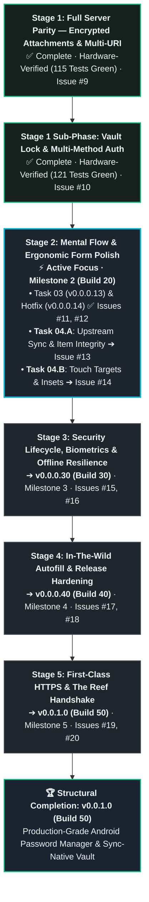

# 🤖 Master Meta-Prompt: ShellGuard Mobile — Subagent Dispatch Tower

> **ORCHESTRATION & DISPATCH GATEWAY FOR GOOGLE AI STUDIO, ANTIGRAVITY & JULES**  
> *Aligned with ClawStack Mobile Standards and Native GitHub Control Tower.*
>
> **Historical Provenance**:
> - **Genesis MVP (Stages 0–8 / Phases 1–7)**: Archived at [`meta-prompt-ai-studio_MVP_GENESIS.md`](../.agents/internal/meta-prompt-ai-studio_MVP_GENESIS.md) (`v0.0.0.11 Build 11`).
> - **Feature Polish Baseline (Stages 1–5 Full Prompts)**: Archived verbatim at [`meta-prompt-ai-studio_FEATURE_POLISH_ARCHIVE.md`](../.agents/internal/meta-prompt-ai-studio_FEATURE_POLISH_ARCHIVE.md).
>
> **Live Source of Truth**: Granular task cards, acceptance criteria, and milestone tracking now live natively in **[GitHub Issues](https://github.com/ClawStackStudios/ShellGuard-Mobile/issues)** and **[GitHub Project #1](https://github.com/orgs/ClawStackStudios/projects/1)**.

---

## 📋 Multi-Stage Execution Strategy



---

## ✅ Completed Historical Stages (Ledger)

| Stage / Phase | Deliverable | Build / Tests | GitHub Issue |
| :--- | :--- | :--- | :--- |
| **Stage 1** | Encrypted Attachments, Hybrid Storage & Multi-URI Bridge (Tasks 01 & 02) | `v0.0.0.11` · 115/115 Green | [Issue #9](https://github.com/ClawStackStudios/ShellGuard-Mobile/issues/9) |
| **Stage 1 Sub-Phase** | Vault Lock Responsiveness, PBKDF2 PIN & In-Place Re-Auth (Tasks 02.A & 02.B) | `v0.0.0.12` · 121/121 Green | [Issue #10](https://github.com/ClawStackStudios/ShellGuard-Mobile/issues/10) |
| **Stage 2 (Task 03)** | Cold-Start Routing, Reconnect Recovery & Sub-16ms Search | `v0.0.0.13` · 127/127 Green | [Issue #11](https://github.com/ClawStackStudios/ShellGuard-Mobile/issues/11) |
| **Stage 2 Hotfix** | Frictionless Self-Signed TLS Consent & CWE-532 Log Redaction | `v0.0.0.14` · 127/127 Green | [Issue #12](https://github.com/ClawStackStudios/ShellGuard-Mobile/issues/12) |

---

## ⚡ Active Stage Dispatch Deck: Stage 2 (`v0.0.0.20` / Build 20)

> **Milestone**: `v0.0.0.20 (Build 20) - Stage 2: Mental Flow & Ergonomic Form Polish`  
> **Context**: [`ROADMAP.md`](../ROADMAP.md) · [`ui-ux-design-system.md`](./ui-ux-design-system.md) · [`routes-and-contracts.md`](./routes-and-contracts.md) · [`room-storage-schema.md`](./room-storage-schema.md)

Copy and paste this prompt to execute **Active Stage 2 (Tasks 04.A & 04.B)**:

```markdown
# STAGE 2 ACTIVE EXECUTION: Upstream Sync Parity & Ergonomic Polish

## 🎯 Objective
Close remaining upstream sync seams against ShellGuard Server Phase 23 Bitwarden Item Integrity, and enforce accessible touch ergonomics and keyboard insets across all views ahead of v0.0.0.20 (Build 20).

### Task 04.A (GitHub Issue #13): Sync & Storage Engine
- `ShellResponse.kt`: Add `= ""` default to `owner_uuid` in `PearlDto`, `SecureNoteDto`, and `SshKeyDto` for trimmed mutation receipts.
- `CreateVaultItemRequest` & `SyncRepository.kt`: Add `password_history: String? = null` parity.
- `SecureAttachmentEntity.kt` & `ShellGuardDatabase.kt`: Add `parentId` & `parentType`, bump Room `version = 2`, implement `MIGRATION_1_2`.
- `ShellGuardClient.kt` & `SyncRepository.kt`: Append `parent_id` & `parent_type` to `uploadAttachmentMultipart`; drain staged attachments cleanly.
- Verify with `SyncRepositoryTest.kt` unit tests.

### Task 04.B (GitHub Issue #14): UI/UX & v0.0.0.20 Release
- Audit all interactive surfaces for >=48dp touch targets.
- Add tactile haptic feedback on secret reveal, clipboard copy, and password generation.
- Polish `.imePadding()` and `LaunchedEffect` auto-scroll above Gboard; refine Secure Notes markdown rendering.
- Bump `app/build.gradle.kts` (`versionCode = 20`, `versionName = "0.0.0.20"`), update `RELEASE-PLAY.md` (<500 chars), cut `RELEASE-v0.0.0.20.md`.
```

---

## 🔭 Downstream Horizons (GitHub Milestones 3–5)

| Stage | Target Release | Tasks & Scope | GitHub Anchors |
| :--- | :--- | :--- | :--- |
| **Stage 3** | `v0.0.0.30 (Build 30)` | **Task 05**: Process-death lock persistence & Airplane Mode offline mutation queue<br>**Task 06**: PIN keypad polish, CircularDialPicker physics & 4-step Panic Purge | [Issue #15](https://github.com/ClawStackStudios/ShellGuard-Mobile/issues/15) · [Issue #16](https://github.com/ClawStackStudios/ShellGuard-Mobile/issues/16) |
| **Stage 4** | `v0.0.0.40 (Build 40)` | **Task 07**: Real-world browser autofill gauntlet (Chrome/Brave/Firefox, 2-step logins)<br>**Task 08**: 16 KB ELF alignment audit (`libsqlcipher.so`) & R8 ProGuard audit | [Issue #17](https://github.com/ClawStackStudios/ShellGuard-Mobile/issues/17) · [Issue #18](https://github.com/ClawStackStudios/ShellGuard-Mobile/issues/18) |
| **Stage 5** | `v0.0.1.0 (Build 50)` | **Task 09**: TOFU `PinningTrustManager` & Instance Anchor ECDSA auto-heal engine<br>**Task 10**: Reef Handshake CameraX QR parser (`shellguard://pair`) & dual-homed mobility | [Issue #19](https://github.com/ClawStackStudios/ShellGuard-Mobile/issues/19) · [Issue #20](https://github.com/ClawStackStudios/ShellGuard-Mobile/issues/20) |

---

## 🔍 Long-Term Testing Invariants & Silent Failure Watchlist

> **CRITICAL ARCHITECTURAL REDLINES** (Tracked in **[GitHub Issue #21](https://github.com/ClawStackStudios/ShellGuard-Mobile/issues/21)**): These failure modes break silently without compile errors or unit test failures.

1. **Certificate Auto-Healing & Rotation Resilience**: Allow **±10 minute clock skew window** on `tls-manifest` timestamps; enforce `manifest.timestamp > previousPinnedTimestamp`; use atomic writes to `EncryptedDeviceVault` preferences.
2. **Network Mobility & Captive Portal Defense**: Health checks must NEVER treat HTTP 200/302 as valid ShellGuard connections without `X-ShellGuard-API: true` or `{ "status": "scuttling" }`. Enforce explicit Ktor timeouts (`connectTimeout = 3s`, `readTimeout = 10s`) for WireGuard Doze re-acquisition.
3. **Serialization & R8 ProGuard Obfuscation Drift**: Protect `TlsManifestDto`, `ServerConnectionProfile`, `PearlDto`, and `ShellResponse` with `@Keep` / ProGuard rules; test `assembleRelease` directly on physical hardware.
4. **Android KeyStore Biometric Invalidation**: Catch `KeyPermanentlyInvalidatedException` gracefully; never crash—invalidate the biometric session and prompt for the master ClawKey (`hu-`).
5. **16 KB Page Alignment & JNI Non-Regression**: Verify `libsqlcipher.so` segments report `Align 0x4000` (`16 KB`) via `readelf -l` before every release build.
